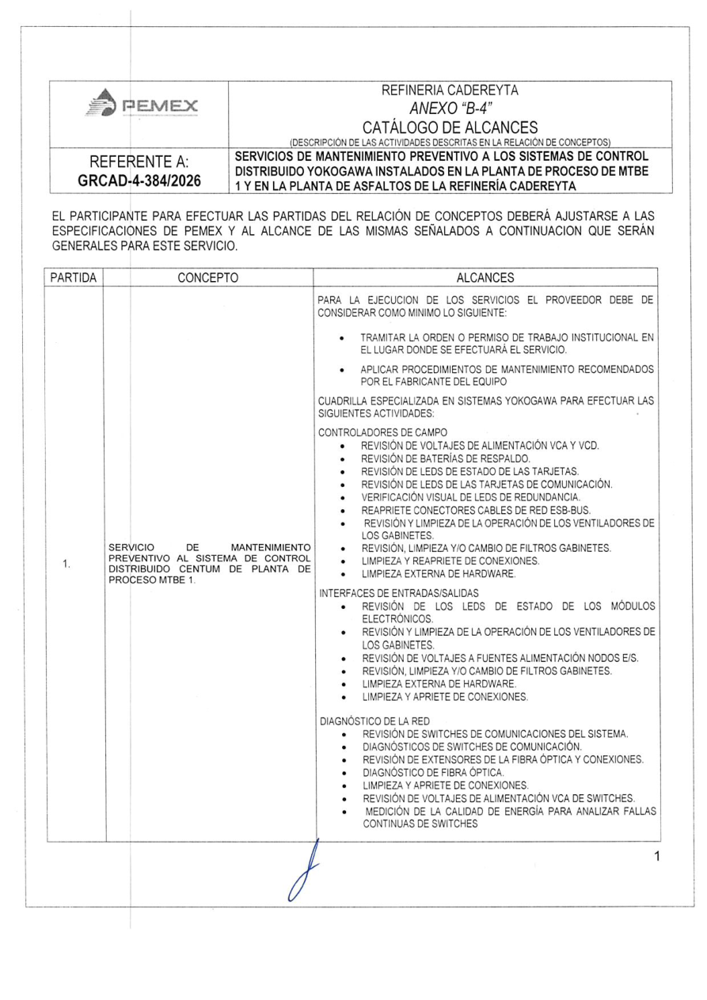
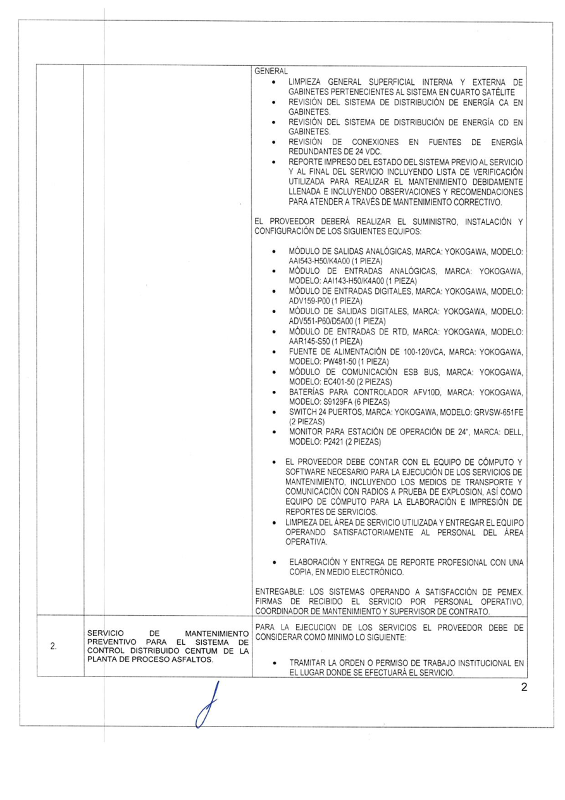
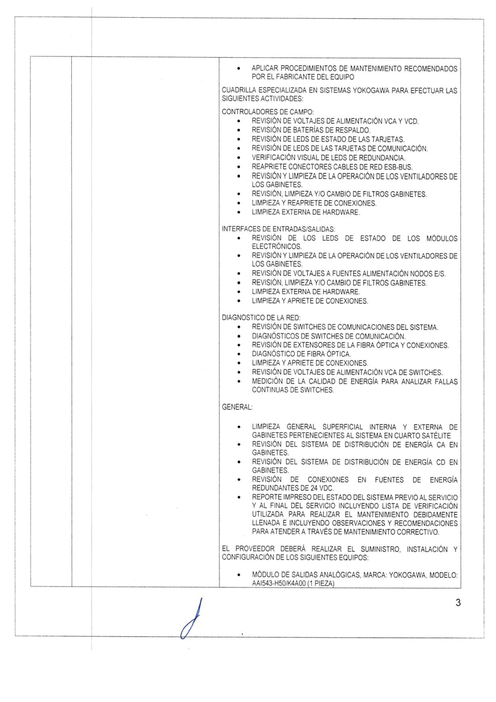
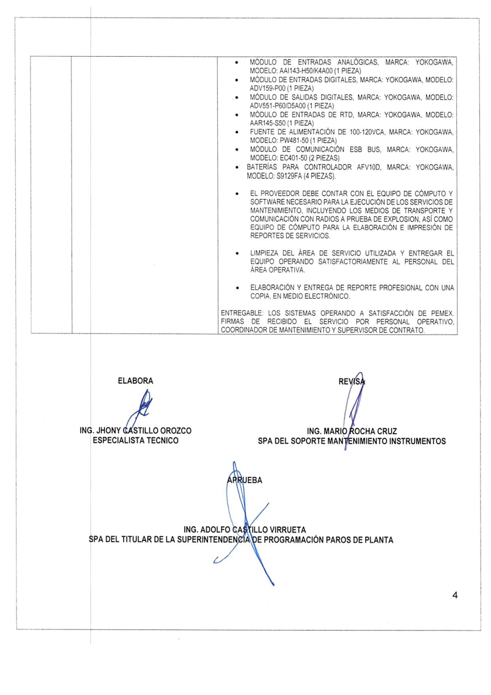

# B-4 — paquete de revisión estructural humana (Phase 3A)

Starting HEAD: dc8f825. Todas las páginas PENDING, approved_by_human=false. No Golden canónico ni rescore.

Fuente original: /Users/ceciliavalencia/LiticIA/backend/.licitia-data/tenders/decd32ae-2c1f-4520-89bc-d845c986a7ba/originals/284bea2c-9302-4ae7-b652-0ce4932fd177/ANEXO B-4.pdf

Documento acf31750-1d8d-4a0c-910c-fc3743930c57, Tender decd32ae-2c1f-4520-89bc-d845c986a7ba, revisión 1; SHA-256 5b1ecdcf6ab0ec6a1008bf41554367dc3a917fce2a79b197a5289193362ba311.

Hashes de página son de los PNG exactos mostrados: página completa, PyMuPDF, zoom 1.5, alpha=false; versión y hash en JSON. No son hashes de texto/OCR. El original no se modifica.

ITEM_1/ITEM_2 son identidades comparativas de calibración, no IDs contractuales. NONE confirma ausencia; UNKNOWN indica indeterminación; KNOWN puede contener varias identidades en los campos de eventos. CLOSES sólo indica cierre del bloque documental. structural_review_expected=false propone que una percepción íntegra de estas fronteras no requeriría revisión por ambigüedad estructural; NO aprueba percepciones actuales ni sustituye esta aprobación humana.

Referencias:
- HUMAN_APPROVED: /Users/ceciliavalencia/LiticIA/backend/evals/semantic_scope_golden_v1.json; SHA-256 ad9d44a67022fa1eaec3181799a88b93c4c6dd04572fff46f31c3ac0c244af86. Alcance: Execution obligations approved on p1; no structural labels.
- HUMAN_APPROVED: /Users/ceciliavalencia/LiticIA/backend/evals/scope_quantity_golden_v1.json; SHA-256 de2327ca868f8b72bf6dd80f50a568807b567f92c4106d65f913b7ce263339e7. Alcance: Quantity excerpts on p4; no structural labels.
- HUMAN_APPROVED: /Users/ceciliavalencia/LiticIA/backend/evals/technical_attribute_golden_v1.json; SHA-256 ad2e3707f5b7a2e53e44339108c14669d9697ad733af3527a8e40216dd7b991b. Alcance: Attribute excerpts on p4; no structural labels.
- HUMAN_REFERENCE_NONCANONICAL: /Users/ceciliavalencia/LiticIA/backend/.licitia-data/tenders/decd32ae-2c1f-4520-89bc-d845c986a7ba/originals/284bea2c-9302-4ae7-b652-0ce4932fd177/ANEXO B-4.pdf; SHA-256 5b1ecdcf6ab0ec6a1008bf41554367dc3a917fce2a79b197a5289193362ba311. Alcance: Authoritative original; structural interpretation requires explicit approval.

DIAGNOSTIC_ONLY: interpretaciones visuales propuestas abajo. MODEL_DERIVED: outputs históricos excluidos de generación; no se consultaron ni usaron como verdad en Phase 3A. Ninguna referencia humana encontrada aprueba estructura por página; los Golden de dominio no suplen esa aprobación.

## PAGE 1

Source page SHA-256: `ea80aa4c697d718a0b281d7bf174b90130eaa9c416f29c1c91a4c441845e2bb1`

PROPOSED:

- incoming_group: NONE
- outgoing_group: KNOWN ITEM_1
- starts_item: KNOWN ITEM_1
- continues_item: NONE
- closes_item: NONE
- visible_item_identifiers: 1. → ITEM_1
- structural_review_expected: false
- approval_status: PENDING; approved_by_human: false

Ordered boundary events:

1. STARTS ITEM_1; locator `page:1|table:first-item-row|partida-column`. Visible 1. beside MTBE 1 concept
2. CONTINUES_OUT ITEM_1; locator `page:1|table:bottom-open-row`. Scope continues onto next page

RATIONALE: Inicio visible 1. en columna PARTIDA, concepto MTBE 1; fila alcanza el borde inferior y sigue en p2.

UNCERTAINTY: No incertidumbre visual principal; confirmar NONE de entrada. MTBE 1 en concepto es planta, no otra partida.

HUMAN DECISION:

- [ ] APPROVE AS PROPOSED
- [ ] CORRECT
- [ ] MARK UNKNOWN

## PAGE 2

Source page SHA-256: `a78371c7cae5b34b1c4482c551c98fbd69b6b9edb878b73ddee9ebdf549a0474`

PROPOSED:

- incoming_group: KNOWN ITEM_1
- outgoing_group: KNOWN ITEM_2
- starts_item: KNOWN ITEM_2
- continues_item: KNOWN ITEM_1
- closes_item: KNOWN ITEM_1
- visible_item_identifiers: 2. → ITEM_2
- structural_review_expected: false
- approval_status: PENDING; approved_by_human: false

Ordered boundary events:

1. CONTINUES_IN ITEM_1; locator `page:2|table:top-continuation`.
2. CONTINUES ITEM_1; locator `page:2|table:upper-block`.
3. CLOSES ITEM_1; locator `page:2|table:horizontal-separator-above-item-2`. Structural closure only, not execution/compliance
4. STARTS ITEM_2; locator `page:2|table:bottom-row|partida-column`.
5. CONTINUES_OUT ITEM_2; locator `page:2|table:bottom-open-row`.

RATIONALE: Bloque superior sin nueva etiqueta continúa 1 desde p1 y termina con entregable/firmas; separador horizontal abre fila 2. Asfaltos al final, con alcance que sigue en p3.

UNCERTAINTY: Confirmar CLOSES como límite del bloque anterior. No significa finalización contractual del servicio. No hay 1. repetido visible aquí; incoming proviene del original p1.

HUMAN DECISION:

- [ ] APPROVE AS PROPOSED
- [ ] CORRECT
- [ ] MARK UNKNOWN

## PAGE 3

Source page SHA-256: `87fe33b7c9ea727378687c6ccf500b95480e1d5c00cefad11437f53077409ef6`

PROPOSED:

- incoming_group: KNOWN ITEM_2
- outgoing_group: KNOWN ITEM_2
- starts_item: NONE
- continues_item: KNOWN ITEM_2
- closes_item: NONE
- visible_item_identifiers: NONE (el pie de página no es partida)
- structural_review_expected: false
- approval_status: PENDING; approved_by_human: false

Ordered boundary events:

1. CONTINUES_IN ITEM_2; locator `page:3|table:top-continuation`.
2. CONTINUES ITEM_2; locator `page:3|table:body`.
3. CONTINUES_OUT ITEM_2; locator `page:3|table:bottom-open-row`.

RATIONALE: La tabla retoma el alcance de la fila 2 iniciada en p2; no tiene nuevo número en columna PARTIDA ni separador de nueva partida. P4 retoma la lista de equipos.

UNCERTAINTY: El 3 del pie es número de página; no se propone como identificador de partida. Confirmar continuidad de 2 usando p2 y p4.

HUMAN DECISION:

- [ ] APPROVE AS PROPOSED
- [ ] CORRECT
- [ ] MARK UNKNOWN

## PAGE 4

Source page SHA-256: `ea42337fe661b9185d27d97ddcea9be9de095a7f05452839e126fdb23a34350b`

PROPOSED:

- incoming_group: KNOWN ITEM_2
- outgoing_group: NONE
- starts_item: NONE
- continues_item: KNOWN ITEM_2
- closes_item: KNOWN ITEM_2
- visible_item_identifiers: NONE (el pie de página no es partida)
- structural_review_expected: false
- approval_status: PENDING; approved_by_human: false

Ordered boundary events:

1. CONTINUES_IN ITEM_2; locator `page:4|table:top-continuation`.
2. CONTINUES ITEM_2; locator `page:4|table:body`.
3. CLOSES ITEM_2; locator `page:4|table:end-above-document-signatures`. Document-local structural closure; no external contractual inference

RATIONALE: La lista de equipos continúa desde p3; termina el bloque con entregable/firmas del servicio. La tabla cierra antes de ELABORA/REVISA/APRUEBA y el documento no tiene otra página.

UNCERTAINTY: Confirmar CLOSES/NONE de salida sólo en este documento de cuatro páginas; no implica que la partida no tenga alcance en otros anexos. El 4 del pie no es partida.

HUMAN DECISION:

- [ ] APPROVE AS PROPOSED
- [ ] CORRECT
- [ ] MARK UNKNOWN

Aprobación pendiente: el usuario debe responder con páginas aprobadas/corregidas y confirmar la interpretación de CLOSES y structural_review_expected. No se ejecuta Phase 3B hasta recibir esa entrada explícita.

## Contrato y validación de Phase 3A

Contrato versionado Pydantic estricto extra=forbid/frozen, schema_version=1. CandidatePack no canónico; approval_status sólo PENDING, approved_by_human sólo false, approval_revision null. UNKNOWN distinto de NONE; KNOWN con identidades; eventos ordenados 1..N y resúmenes coherentes; documento/versión/página/hashes obligatorios. La ruta de escritura del candidato rechaza evals/ y cualquier nombre canónico. MODEL_DERIVED no puede conferir aprobación. No se implementa la aprobación de Phase 3B.

Archivos nuevos: backend/app/document_intelligence_structural_golden.py y backend/tests/test_document_intelligence_structural_golden.py; actualización mínima docs/roadmap.md. Outputs untracked: este paquete, b4_structural_golden_candidate_v1.json y cuatro PNG en b4_structural_golden_review_pages/. No producción existente, schema, migraciones, métricas ni Golden canónico modificados.

HG01 contrato; HG02 UNKNOWN/NONE; HG03 multieventos; HG04 orden; HG05 hash; HG06 provenance; HG07 candidato no aprobado; HG08 false por defecto; HG09 modelo no aprueba; HG10 cero providers; HG11 original intacto; HG12 sin dependencia Vision; HG13 determinismo; HG14 Tender ajeno rechazado; HG15 ruta canónica rechazada. Todos PASS.

Comando de validación: /Users/ceciliavalencia/LiticIA/backend/.venv/bin/python -m pytest tests/test_document_intelligence_structural_golden.py tests/test_document_intelligence_calibration.py tests/test_document_intelligence_calibration_fidelity.py -q, desde backend con DATABASE_URL apuntando a licitia_test. 74 passed: HG15 + CAL29 + HF30; seis warnings existentes SWIG/PyMuPDF y python_multipart. Regresión existente mantiene sus diagnósticos sin consumir las etiquetas propuestas ni crear rescore Phase 3B.

Compileall app/scripts/tests PASS. Alembic licitia_test current/head 20261013_req_perception_prov_072; ninguna migración nueva. Git diff --check y whitespace de archivos nuevos PASS al entregar. Provider calls=0; fuente Tender #001 intacta; Tender #002 no consultado; sin stage/commit/push.

STOP: autorización requerida por la solicitud del usuario: «CODEX MAY NOT APPROVE ITS OWN LABELS». Falta aprobación explícita página por página; no existe Golden canónico y no se ejecutó Phase 3B/rescore.
