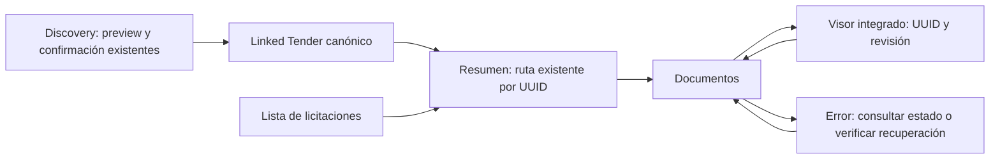

# UI-R3 — Evaluación arquitectónica y diseño de producto

Estado: **PROPUESTA — pendiente de aprobación arquitectónica y visual**. Fecha: 2026-10-23.
Esta entrega sólo analiza y planifica; UI-R3 funcional no implementado.

## 1. Baseline, autoridad y alcance

HEAD verificado antes de escribir: `1d73dcd1738162ed5e0edbf2993a9415d247f170`,
`feat(ui): complete UI-R2 discovery and visual polish`. Padre UI-R1: `d0398f17f4b46c4a74046513aaced1451ad52951`.
Índice inicialmente vacío; ningún archivo rastreado modificado; 22 directorios históricos
sin seguimiento bajo `backend/reports/`. No se modifican, mueven ni incorporan.

La aceptación humana cierra UI-R2/UI-R2.1. Sus reportes y ADR conservan el estado histórico
previo a commit; no son la autoridad para negar el cierre actual. Esta fase no los reescribe.
MVP-01–10 CLOSED; UI-R3 cubre **lista/creación manual, Resumen y Documentos/visor/recovery**.
Sin cambios de backend, contratos, migraciones, motores, proveedores, budgets o módulos
Requisitos/Cumplimiento/Partidas/Comercial/Preparación/Propuesta. Discovery conserva su
handoff y su restricción Compras MX. No auth nueva, dependencias ni refactor general.

Fuentes leídas y contrastadas: [README](../README.md), [visión](vision.md),
[arquitectura](architecture.md), [modelo](domain-model.md), [roadmap](roadmap.md),
[Golden #001](golden-tender-001.md), [contrato visual](RX23_TUSCOPE_PRODUCT_UI_RECONCILIATION_v1.md),
[ADR-0035](adr/0035-product-ui-shell-navigation.md), [ADR-0036](adr/0036-inicio-discovery-product-ui.md),
[UI-R1](ui-r1-app-shell.md), [UI-R2](ui-r2-inicio-discovery.md),
[UI-R2.1](ui-r2-1-visual-polish.md), [flujo Workspace](workspace-functional-flow.md),
[ADR-0020](adr/0020-workspace-canonical-composition.md),
[ADR-0021](adr/0021-local-backup-restore-safe-retry.md) y
[handoff Discovery](discovery-monitoring-handoff.md).
El modelo conceptual enumera campos futuros; esta propuesta usa sólo schemas y handlers reales.
No se encontraron documentos obligatorios ausentes. Stitch está fuera del repositorio:
`/Users/ceciliavalencia/Downloads/stitch_licitia_gesti_n_de_licitaciones_pro/`.
Se inspeccionaron visualmente `NuevaLicita.png`, `VisorDoctos.png` y se leyó
`licitia_professional_system/DESIGN.md`; no se ejecutaron HTML, scripts ni CDN.

## 2. Diagnóstico arquitectónico

`ProductApp.tsx` compone AppShell, hash routes y el workspace `App.tsx`. Las ocho secciones
Tender hoy son anclas: un MutationObserver busca `workspace-{section}`, abre disclosures
y desplaza el contenido. No son pantallas aisladas. La instancia visitada se mantiene
montada/oculta para conservar formularios (ADR-0035).

`App.tsx` concentra tipos, estado, lecturas, importación, conflicto, extracción, OCR,
clasificación, referencias y numerosos módulos posteriores. Al montar lee Tenders,
empresas y estado de Vision. Al seleccionar Tender lee documentos, proveedores, auditoría,
eventos, cambios, effective-state, snapshot, evaluación y requisitos. **Ocultar JSX no
elimina esas lecturas ni desacopla esos efectos**. No hay adquisición automática por esas
lecturas, pero no deben reutilizarse como supuesto dashboard mínimo de Resumen.

`WorkspaceFlow` consulta `/workspace`, observa cambios de documentos y hace polling cada
2 s sólo en PROCESSING. Su GET no adquiere proveedores, pero devuelve Scope y Requirements
y monta superficies posteriores al recibir datos. No conviene montarlo entero para mostrar
un estado operacional. UI-R3 puede reutilizar DTO/handlers mediante extracción local de
presentación, conservando el workspace completo en Diagnóstico y los destinos futuros.
No requiere reescribir servicios ni imponer un store/router nuevo.

Recomendación: composición enfocada dentro de las rutas existentes; lista y Resumen con
lecturas mínimas, Documentos con lista/visor y acciones explícitas. Cualquier aislamiento
de efectos se limita al entrypoint y a esta superficie, con pruebas de no regresión.
El [ADR-0037 propuesto](adr/0037-tender-documents-product-ui.md) registra esta decisión
porque cambia el ciclo de montaje respecto del puente transitorio UI-R1.

## 3. Matriz de capacidades y contratos comprobados

Convención: T = `/tenders/{tender_id}`; D = T`/documents/{document_id}`.
IMPLEMENTADA describe capacidad funcional, no diseño de producto terminado.

| Capacidad / estado | Implementación actual | Contrato/API | Componente existente | Propuesta UI-R3 | Riesgo / límite |
|---|---|---|---|---|---|
| Lista — IMPLEMENTADA | `main.py:list_tenders`, orden created_at DESC, colección completa | GET `/tenders`, `TenderRead` | `App` picker; Inicio tabla reciente | Tabla compacta con filtros locales | Sin paginación ni filtros servidor; no inventar total parcial |
| Creación — IMPLEMENTADA | `create_tender` → `tender_creation.create_record`, DRAFT | POST `/tenders`, `TenderCreate` | `App.handleSubmit` | Formulario plegable, título obligatorio; perfil/referencia opcionales | Sin idempotency key para creación manual; respuesta perdida puede duplicar al repetir |
| Estado/perfil — PARCIAL | `Tender.status`, perfil string nullable | `TenderRead`: id/title/profile/reference/status/created_at/updated_at | Picker y header | Etiquetas Borrador/Activa/Archivada; perfil literal | No PATCH Tender ni catálogo de perfiles verificados; no editor/selector ficticio |
| Entrada Discovery — IMPLEMENTADA | Link y receipts persistidos; create explícito | `/discovery/opportunities/{id}/tender-preview`, `/create-tender` y `/tenders/{id}/documents` bajo Opportunity | `DiscoveryDetail`, callback `openTender` | Mantener Abrir → Resumen por ID canónico | TenderRead no trae Opportunity ID/origen; sin búsqueda inversa/fanout |
| Identidad Tender — IMPLEMENTADA | UUID y ownership en DB | GET T; GET `/tenders` | Contexto de `App`/`ProductApp` | Encabezado con datos reales, ID sólo diagnóstico | No fechas contractuales en TenderRead |
| Registro documental — IMPLEMENTADA | `TenderDocument`, FK Tender, UNIQUE Tender+SHA | GET T`/documents`, `TenderDocumentRead` | `loadDocuments`, listado App | Tabla/revisiones, detalle y selector para visor | Registro importado no prueba existencia física actual |
| Importación — IMPLEMENTADA, integración PARCIAL | multipart, resultados por archivo, commit por original | POST T`/documents/import`, `DocumentImportResult[]` | `handleImport` | Entrada explícita, outcomes completos | Seleccionar hoy importa inmediatamente; conflicto múltiple mal correlacionado (§8) |
| Duplicado/conflicto/revisión — IMPLEMENTADA backend | SHA, NAME_CONFLICT, IMPORT_INDEPENDENT, NEW_REVISION | mismo POST, conflict_action y revision_of_document_id | `resolveConflict`, formulario App | Decisión humana por archivo/target, confirmación antes de revisión | No agrupar por nombre como identidad; target sólo mismo Tender/vigente |
| PDF local — IMPLEMENTADA | ownership + path resolver + archivo; MIME/ext PDF | GET D`/content`, FileResponse inline | iframe App | Visor integrado y abrir original local | No visor Office ni endpoint genérico de descarga |
| Texto/páginas — IMPLEMENTADA | páginas por documento ordenadas, OCR alternativo persistido | GET D`/pages`, `DocumentPageRead[]` | Panel texto por página App | Texto derivado separado del original, página/fragmento | Página seleccionada no controla iframe hoy; sin highlights exactos |
| Estado Native — IMPLEMENTADA | PENDING/COMPLETE/PARTIAL/FAILED/NO_NATIVE_TEXT | processing_status, page_count y text_extracted_at de documento | App metadata | Etiquetas específicas de extracción | No equivale a pipeline completo ni certeza semántica |
| Composición canónica — IMPLEMENTADA | `workspace_flow.py`, AVAILABLE_ONLY | GET T`/workspace`; POST T`/workspace/process` | `WorkspaceFlow`, `workspaceApi` | Bloque operacional acotado en Documentos; acción explícita | GET es DTO completo, sin nuevo endpoint ligero; no prometer job background |
| Retry — IMPLEMENTADA | `workspace_recovery.retry_status`, fingerprint y lock | GET T`/workspace/recovery`; POST T`/workspace/retry` con expected_fingerprint | `recoveryApi`, WorkspaceFlow | Verificar recuperación → reintentar si elegible | No reset, borrado, retries de proveedor ni presupuestos nuevos |
| DI por documento — IMPLEMENTADA | extracción/clasificación/referencias explícitas | POST D`/extract-pages`, `/classify`, `/analyze-references`; GET `/classification`, `/references` | Handlers y paneles App | Disclosure herramientas existentes, sin ejecutarlas al abrir | Extracción low-level regenera páginas; no confundir con retry seguro |
| OCR/Vision — IMPLEMENTADA acotada | acciones/policies existentes | POST D`/ocr`, `/vision-analyze`; GET resultados/proveedores | Controles App | Conservar acceso explícito en herramientas/diagnóstico, sin rediseño de política | Nunca escalar por interpretación no resuelta; no activar al montar |
| Referencias internas DI — IMPLEMENTADA | menciones, targets, candidates, decisiones | GET D`/references`, GET T`/relationships`, PATCH T`/references/{id}` | Panel App | Separar mención/target/resolución humana | Referencia no resuelta no prueba archivo disponible |
| Referencias públicas — IMPLEMENTADA en Discovery | SourceDocument + receipt, vínculo | Opportunity preview/importations existentes | DiscoveryDetail | Permanecen allí; enlace de retorno sólo si contexto conocido | No mezclar lista remota con `TenderDocument[]` ni descargar por visita |
| Disponibilidad física de todos — NO DISPONIBLE como bulk | comprobada al leer contenido/recovery | Sin HEAD/bulk availability verificado | Ninguno | “Registrado localmente”; error real al abrir PDF | No badge “verificado en disco” deducido de metadata |
| Edición Tender / Office / highlights — NO DISPONIBLE | Sin contrato de producto verificado | Sin API correspondiente | Ninguno | Omitir controles, declarar limitación | Requiere slice/backend aprobado aparte |

Fuentes de código: [App](../frontend/src/App.tsx), [ProductApp](../frontend/src/ProductApp.tsx),
[routes](../frontend/src/ui/routes.ts), [primitives](../frontend/src/ui/primitives.tsx),
[WorkspaceFlow](../frontend/src/components/WorkspaceFlow.tsx), [workspace API](../frontend/src/api/workspace.ts),
[backend handlers](../backend/app/main.py), [schemas](../backend/app/schemas.py),
[models](../backend/app/models.py), [creación](../backend/app/tender_creation.py),
[recuperación](../backend/app/workspace_recovery.py), [vínculos Discovery](../backend/app/discovery_models.py).

Persistencia: Tender en PostgreSQL; originales inmutables en filesystem, metadata/rutas/hash
en DB; cada revisión es otro TenderDocument enlazado por revision_of_document_id, no una
entidad UI nueva DocumentVersion. Derivados por página/versiones conservan provenance.
Estado Workspace en filesystem por Tender, último intento y lock; no nuevo job/table.
Filtros/selección/drafts UI en memoria; `licitia_selected_tender_id` es preferencia, no autoridad.

Autorización actual: entorno local/UAT controlada sin autenticación/roles de usuario.
Ownership Tender/documento y validación de rutas no equivalen a autenticación.
No añadir RBAC ni afirmar seguridad multiusuario. Confirmación humana para cambios persistentes
materiales y revisiones; backend conserva la autoridad de ownership, integridad y concurrencia.

## 4. Diseño visual y wireframes

Usar AppShell navy/light existente, tokens semánticos, tipografía local 30/20/16/14/13,
espaciado 4/8/12/16/24, `Button`, `StatusBadge`, `TableShell`, `Notice` y estados compartidos.
Un h1; encabezados de sección sin duplicar nombre del expediente. Sin KPIs/porcentajes/charts.
Stitch aporta tabla/selección documental y foco en lectura. Se descartan su pipeline IA
automático, contadores de ejemplo, menú duplicado, highlight sin geometría y soporte Office
sugerido por la imagen. No importar su HTML/datos ni añadir drawer genérico innecesario.

### Pantalla 1 — Licitaciones (`#/licitaciones`)

```text
AppShell / PageHeader: Licitaciones                  [Crear licitación]
[Buscar título o referencia] [Estado: Todos] [Perfil: Todos] [Aplicar]
Referencia / Título | Perfil institucional | Estado | Registro actualizado | Abrir
... TableShell, filas compactas, orden updated_at DESC / ID ...
[Crear licitación: sección expandida sólo al solicitar]
  Título* / Referencia opcional / Perfil institucional opcional (texto)
  [Cancelar] [Crear licitación]
```

Filtros locales del conjunto completo: texto título/referencia, estado exacto y perfil literal
con valores reales (incluido Sin perfil). Conteo “N de M licitaciones guardadas”, no procesos
nacionales; sin solicitudes por fila. No columna readiness, monto, fechas de cierre ni origen
Discovery inferido. Título/referencia en una columna, cinco columnas total; ID en diagnóstico.
No acciones de activar/archivar/editar/eliminar, dado que no hay contrato Tender correspondiente.

Carga: LoadingState; error: ErrorState con Volver a consultar, jamás vacío falso. Vacío real:
“Aún no hay licitaciones”, Crear/Discovery. Filtro sin resultados: Limpiar filtros, sin sugerir
que no hay expedientes. Creación agrupa sólo tres campos, max255, título trimmed requerido.
Tras 201 usar ID devuelto para abrir Resumen y actualizar listado; no buscar por título.
Doble clic bloqueado mientras pendiente. Fallo ambiguo de POST exige consultar lista antes de
repetir; no se afirma idempotencia backend. Cancelar con borrador solicita confirmación.

### Pantalla 2 — Resumen (`#/licitaciones/{id}/resumen`)

```text
PageHeader: título / referencia · estado registrado
TenderContextNav (ocho secciones actuales)
Datos del registro: perfil / creado / actualización de registro
Documentos del expediente: N revisiones registradas · V vigentes · S sustituidas
[Ir a Documentos]                                  [Actualizar vista]
Nota: originales y revisión humana siguen siendo la autoridad
```

Lecturas previstas: GET T + GET T`/documents`; cache compartida con lista/documentos cuando
sea válida, consulta por ID directo al refrescar deep link. Conteos derivan exclusivamente
de documents.length e is_current, rotulados como revisiones registradas; no archivos físicos
verificados, familias lógicas ni documentos correctos. Fallos independientes: registro visible
si falla documentos; “No disponible”, no cero. Fechas created_at/updated_at son del registro,
no publicación/cierre ni actividad total del expediente. Sin eventos/readiness/comercial sólo
para llenar pantalla. Procesamiento/recovery vive en Documentos, no exige `/workspace` aquí.
Reutilizar la navegación contextual; no segunda grilla de ocho tarjetas/enlaces duplicados.

### Pantallas 3 y 4 — Documentos con visor integrado

Ruta actual `#/licitaciones/{id}/documentos`; visor es selección interna, sin ruta nueva.

```text
PageHeader + TenderContextNav
Documentos                              [Importar documentos] [Actualizar lista]
[Nombre] [Revisiones: Todas/Vigentes/Sustituidas] [Estado de extracción]
Archivo | Revisión/vigencia | Formato | Extracción/páginas | Importado | Ver
[Importación explícita / resultados por archivo / conflictos pendientes]
[Procesamiento del expediente: estado real + acciones explícitas + recovery]
──────────────────────────────────────────────────────────────────────────
Lista compacta 240 px | nombre seleccionado / revisión / Abrir PDF local
revisión seleccionada| [PDF inline flexible, altura relativa al viewport]
                     | [Texto por página] [Contexto e integridad ▸]
                     | [Herramientas existentes ▸]
```

La tabla sirve para consultar todo; al abrir un documento se repliega como selector compacto
para no duplicar dos listas completas. Selector conserva cada UUID/revisión, nunca colapsa
por filename. Mostrar sustituidas con etiqueta y permitir abrirlas. `is_current` no certifica
vigencia contractual. Al volver del visor: filtros, scroll y foco en la fila de origen.
Panel contextual plegable, no tercer panel fijo en1366. En1920 puede ampliarse lectura,
sin imponer tres paneles. En768/390 alternar lista/visor en una columna, tabla con scroll local,
selector “Volver a lista”, acciones accesibles y sin overflow global. Sidebar existente plegable.

Importación separada de procesamiento. Propuesta: selección local → revisión de nombres →
Importar; esta confirmación sólo cambia presentación/dispatch explícito, no contrato multipart.
No drag/drop ni carpetas prometidos: input actual multiple, aunque copy legacy menciona carpeta.
Conservar resultados IMPORTED/DUPLICATE/NAME_CONFLICT/FAILED por archivo, sin progreso ficticio.
Conflicto: identificar archivo real, elegir independiente o revisión actual, confirmar/cancelar;
ningún target preaceptado por posición. Resolver múltiples exige decisión §9 antes de implementar.

Cuatro categorías siempre diferenciadas:

1. Referencia externa: enlace/metadata pública en Discovery; no archivo local ni extracción.
2. Documento registrado localmente: UUID/revisión/hash; lectura física puede fallar.
3. Texto extraído: estado Native específico, páginas y alternativas OCR cuando existan.
4. Resultados derivados: clasificación/referencias/evidencia, sus fuentes y revisión; no son original.

Contexto: filename literal escapado React, revisión, vigencia registrada, fecha de importación,
MIME/tamaño; SHA/path/IDs bajo Integridad/Diagnóstico. Sin ruta de filesystem como enlace.
PDF se sirve sólo por D`/content`. Office/otros: metadata y texto derivado **si existe**, mensaje
“Este formato no tiene vista previa local”; sin convertir, abrir portal ni ofrecer descarga
inexistente. `page_count=0` no prueba PDF vacío ni no soportado.

Navegación de página del texto: usa page_number real; para abrir PDF en página solicitar
`content#page=N`, con fallback visible a texto/fragmento si el visor nativo no lo respeta.
No se puede leer/controlar de forma fiable la página/zoom actual del plugin desde React;
no simular sincronización ni toolbar de zoom propia. Cambiar documento anterior/siguiente usa
lista filtrada por UUID, indica sus límites, conserva identidad histórica. Sin fuente válida:
“Página no disponible”/“Fuente no disponible”, nunca saltar a revisión vigente.

Errores: pages GET fallido debe distinguirse de “sin texto”; reconsultar es lectura, no extracción.
iframe load no prueba éxito HTTP/render del plugin: mostrar Abrir PDF local y reabrir visor;
no afirmar “validado” por onLoad. Si se necesita diagnóstico de contenido, GET explícito al
mismo endpoint y tratamiento 404/400/red, sin HEAD/API nuevos ni descarga masiva preventiva.
No garantizar detección de todo error del plugin. Texto derivado permanece accesible con aviso
si el original falta; no presentarlo como sustituto autoritativo.

Procesamiento: reutilizar AVAILABLE_ONLY, GET estado, POST únicamente desde acción humana.
Etiquetas NOT_PROCESSED/PROCESSING/COMPLETED/COMPLETED_REVIEW_REQUIRED/PARTIAL/FAILED/
INTERRUPTED/STALE traducidas; sin porcentaje, ETA o certificación. Polling2s sólo al observar
PROCESSING, sin crear segundo timer por panel; preservar consulta de una ejecución iniciada
aunque se cambie de sección, con una única instancia por Tender. Verificar recuperación sólo
al solicitar; retry exige eligible y fingerprint actual. 409 invalida elegibilidad y exige
reverificar, sin borrar resultados. provider_degraded no implica que todo Native sea inválido.
Herramientas low-level explícitas conservan acceso y advertencia de regeneración; no presentarlas
como sustituto de recuperación segura ni modificar OCR/Vision/política de adquisición.

## 5. Flujos y ciclo de vida propuestos



Crear desde Discovery conserva selección vacía inicial, expected_binding, recibos y guards;
UI-R3 sólo recibe ID para Abrir. No nuevo create al abrir. Retorno Discovery usa historial o
contexto de navegación conocido; entrada directa a Tender no fabrica origen ni escanea todas
las Opportunities. Referencias públicas continúan en Discovery con importación explícita allí.
No prometer nuevo enlace contextual desde todos los motores fuente en UI-R3: los enlaces
actuales `content#page` preservan revisión y página; migrarlos en módulos R4/R5 queda fuera.

Estado por identidad: selección y requests de Documentos ligados a (TenderID, DocumentID).
Respuesta tardía de otro ID se descarta con cancelación/generación. Cambio de Tender limpia
estado visible anterior y confirmaciones; borrador/import File pendiente requiere confirmar
abandono, no aplicarlo al nuevo Tender. Navegar sólo entre Resumen/Documentos conserva selección
y filtros en memoria. No persistir File en localStorage ni introducir drafts en backend.
Refresh pierde borradores no guardados; avisar cuando aplique. No remontar módulos posteriores
para cada cambio de tab ni cambiar su estado interno. No refactor general como prerrequisito:
extraer sólo UI-R3 y mantener adapter legacy para las otras secciones/Diagnóstico.

## 6. Riesgos reales, mitigaciones y pruebas sugeridas

| Riesgo / evidencia | Mitigación propuesta | Prueba de aceptación |
|---|---|---|
| Conflicto de archivo incorrecto: `App.handleImport` usa `selectedFiles[0]` con `conflicts[0]`; sólo un pendingConflict | Hallazgo estático, no corregido. Autorizar corrección acotada separada o bloquear resolución múltiple con explicación; nunca reutilizar ciegamente | Lote A sin conflicto + B con conflicto; bytes/nombre/ruta B deben coincidir; dos conflictos no se pierden |
| Selección rápida mezcla páginas: `loadDocumentPages` no tiene generation guard y convierte error en [] | Guard por Tender/Document y error separado en superficie R3 | Resolver respuesta A después de B y rechazarla; fallo no dice Sin texto |
| Lecturas ajenas al abrir Resumen, App effect amplio | Entrypoints enfocados y cache mínima; no simple CSS hidden | Spy GET: Resumen sólo registro/documentos; sin fanout readiness/requisitos/proveedores |
| Drafts/formularios perdidos al aislar pantallas | Estado estable por Tender, confirmación abandono, no remontaje fuera de alcance | Draft vuelve intacto tras tab ida/vuelta; cambio Tender no lo traslada |
| POST manual con respuesta perdida duplica Tender | Sin retry automático; recargar lista y revisar antes de repetir | Error tras envío no vuelve a enviar al montar ni reintenta solo |
| Conflicto NEW_REVISION cambia vigencia | Confirmar target actual por ID; refrescar ante error; autoridad backend | Target sustituido/ajeno rechazado; contenido/estado anterior permanecen |
| Procesar/extract involuntario o concurrente | Cero writes por montaje/selección/filtros; botones busy; locks backend intactos | Cero POST/PATCH tras recorrer rutas/visor;409 no resetea |
| Regeneración por low-level extract-pages elimina páginas antiguas antes de recrear | Conservar acceso técnico con advertencia y confirmación; no ejecutar como recovery silencioso | Abrir visor no invoca extract; retry sólo endpoint canónico |
| Estado parcial/proveedor caído se interpreta como expediente vacío | Mensaje de parcialidad, conservar evidencia válida y error por sección | Native visible con provider_degraded; error no fabrica cero |
| Referencia pública o registro DB presentado como archivo disponible | Etiquetas diferenciadas; availability confirmada sólo por lectura real | Reference sin receipt no aparece como local;404 no afirma disponible |
| Fuente histórica redirigida a revisión vigente | URL por UUID exacto y página; no resolver por nombre | Dos revisiones mismo nombre abren distintos content, incluida sustituida |
| Contenido remoto o path inseguro | React escaping, URLs del endpoint local, sin raw HTML ni path concatenado | Nombre hostil no inyecta DOM; backend path traversal/ownership sigue verde |
| iframe PDF falla sin señal fiable | Fallback Abrir local/Texto/Reabrir, no éxito inferido de onLoad | PDF/plugin no disponible conserva contexto y alternativas |
| UI nueva afecta R4/R5 ya cerrados | Adapter legacy y límites por props; sin cambios de dominio | Navegar a las cinco secciones posteriores conserva inputs y contratos |

No se reprodujeron bugs con datos de producto ni se certificó su impacto en runtime.
Los dos primeros son hallazgos estáticos concretos; no bloquean esta propuesta, sí exigen
resolver su tratamiento antes de aceptar la implementación documental correspondiente.

## 7. Plan de implementación sujeto a aprobación

1. Fijar pruebas de rutas/lecturas y decidir tratamiento de conflictos; baseline de archivos
   aceptados y evidencia existente. No tocar datos reales ni Tender #002.
2. Separar presentación lista/creación dentro del entrypoint actual; usar ID de respuesta,
   filtros locales y estados vacíos/error. Mantener campos y POST intactos.
3. Componer Resumen con TenderRead/documentos y rutas actuales. Mantener legacy para otros
   destinos sin duplicar workspace ni introducir consultas masivas ocultas.
4. Extraer lista/import/visor/contexto documental, preservando handlers/DTO; guard de identidad,
   estados separados y retornos. Aplicar decisión aprobada sobre conflictos.
5. Integrar bloque operacional/recovery por extracción mínima de WorkspaceFlow; conservar
   una fuente de estado/polling, sin rehacer su composición semántica o módulos posteriores.
6. Pulir responsive/teclado y correr pruebas apropiadas. Reportar resultados reales, capturas
   sintéticas aisladas y cualquier dependencia no resuelta antes de declarar completo.

Archivos existentes probablemente afectados en implementación (no en esta entrega):
`frontend/src/ProductApp.tsx`, `frontend/src/App.tsx`, `frontend/src/components/WorkspaceFlow.tsx`,
`frontend/src/App.test.tsx`, `frontend/src/ui/Shell.test.tsx`,
`frontend/src/components/WorkspaceFlow.test.tsx`. `ui/routes.ts` sólo si hace falta tipar
contexto existente: **ninguna nueva ruta requerida**. Wrappers nuevos pueden reflejar endpoints
existentes; no alterar contratos de `api/workspace.ts` ni `api/discovery.ts`.

Componentes candidatos mínimos, nombres propuestos:
`TenderListView.tsx`, `TenderSummaryView.tsx`, `TenderDocumentsView.tsx`,
`DocumentViewer.tsx`, y `WorkspaceProcessingControls.tsx` si permite reutilizar el bloque
sin montar resultados ajenos; `tenderDocuments.css` acotado y `api/tenders.ts`/`api/documents.ts`
para DTO ya existentes. Evitar componentes de infraestructura genéricos y un segundo store.
Tests colocados junto a estas superficies y script `frontend/scripts/ui-r3-browser.mjs`.
No backend, modelos, schema, dependencias ni configuración de proveedores previstos.

## 8. Verificación propuesta y criterios de aceptación

Pruebas existentes inspeccionadas (no ejecutadas en esta fase):
`frontend/src/App.test.tsx` (selección/restauración/formulario/cero writes),
`ui/Shell.test.tsx` (rutas, contexto, no remount, drafts),
`components/WorkspaceFlow.test.tsx` (ownership/provenance, explicit process, error, fingerprint/retry),
`backend/tests/test_tenders.py` (create/list/get), `test_documents.py` (duplicados/revisiones,
rollback, PDF, no-PDF, foreign, missing, traversal, referencias y OCR),
`test_workspace_recovery.py` (RH308/309/310, fingerprint, integridad, receipts),
`test_discovery_handoff.py` (vínculo/import), scripts browser UI-R1/UI-R2.
Estos tests demuestran cobertura definida; esta inspección no es una ejecución nueva ni
prueba de calidad DI/proveedor. No relajar assertions de dominio para adaptar labels.

| Gate propuesto | Criterio verificable / prueba futura |
|---|---|
| R3-01 lista | Todos los Tender del GET se representan; filtros locales exactos, sin estados ni métricas inventados |
| R3-02 creación | Sólo submit válido hace POST;201 navega por ID; fallo incierto no reenvía; draft protegido |
| R3-03 entradas | Discovery e Inicio abren el mismo UUID; refresh/back no crean/importan/procesan |
| R3-04 resumen | Sólo GET T/documentos; fallos independientes, conteos de revisiones exactos, sin fanout |
| R3-05 original | UUID/revisión/sha preservados, sustituido visible, página real/fallback sin salto de versión |
| R3-06 import | Outcomes por archivo; duplicado no crea copia; conflicto y target correctos o resolución expresamente bloqueada |
| R3-07 identidad | Respuesta tardía A no contamina B; cambiar Tender invalida confirmación y fuentes anteriores |
| R3-08 percepción | Montar/filtrar/abrir visor no llama process/extract/OCR/Vision/LLM; tools sólo por acción explícita |
| R3-09 recovery | eligible+fingerprint;409 exige reverificar; evidencia parcial conservada; sin reset/budget nuevo |
| R3-10 errores | API caída≠vacío; sin PDF local≠sin metadata; texto fallido≠sin texto;Office sin visor ficticio |
| R3-11 contexto | Borradores/scroll/selección vuelven; módulos posteriores no remontados por cambios R3 |
| R3-12 visual |1366×768,1440×900,1920×1080,768×900,390×844,zoom200%; tabla local, visor útil y acción accesible |
| R3-13 a11y |Teclado completo, retorno foco, labels, landmarks/h1, estados anunciados, contraste4.5:1 texto/3:1 controles |
| R3-14 límites |Sin backend/API/migraciones/dependencias/corpus/históricos alterados; guards Compras intactos |

Secuencia futura: focused nuevos + App/Shell/WorkspaceFlow → regresión frontend completa →
`npm --prefix frontend run build` y `run typecheck` → browser UI-R3 y regresión UI-R2 →
`git diff --check`. Adaptar browser fixtures sólo en tests aislados, no datos productivos.
Si se toca wiring de import/recovery, justificar regresión backend acotada por superficie:
`tests/test_tenders.py tests/test_documents.py tests/test_workspace_recovery.py` y handoff
si corresponde; intérprete y DB test obligatorios de backend/AGENTS.md. No ejecutar opt-ins
reales ni suites ajenas por hábito. Ningún blind Attempt. Preservación histórica sólo hashes
mediante mecanismo establecido cuando se implemente; no explorar contenido ciego.

## 9. Decisiones pendientes y dependencias futuras

Aprobar: (a) Resumen mínimo sin readiness ni `/workspace`; (b) visor integrado sin ruta nueva;
(c) aislamiento local de montaje/lecturas sin refactor de módulos posteriores; (d) documentos
con revisiones explícitas y herramientas técnicas plegables; (e) acción importar separada de
selección y confirmación de revisiones; (f) corregir correlación múltiple en slice acotado
previo/autorizado, o restringir resolución múltiple de forma explícita para UI-R3.
No asumir autorización de corrección funcional de (f) por haber encontrado el problema.

Futuros fuera de UI-R3: PATCH/optimistic revision Tender, catálogo de perfiles, disponibilidad
bulk, descarga de originales no-PDF, visor Office, highlights con geometría, reverse-link
Tender→Opportunity y endpoint operacional ligero. Alternativa vigente: sólo lectura/campos
literales, metadata/texto disponible, PDF local, retorno de navegación conocido y DTO completo
Workspace sólo donde se usa. Ninguna dependencia futura es prerrequisito para el diseño acotado.

## 10. Verificación de esta entrega documental

Sólo se crean este archivo y ADR-0037 **propuesto**, sin modificar archivos existentes.
Validación: HEAD/parent/status/índice, referencias locales de ambos documentos y
`git diff --check`. No se ejecutaron suites runtime, build, DB, migraciones ni proveedores:
esta fase es análisis y no presenta los195 frontend/38 API previos como resultados nuevos.
No pruebas de portales, descargas binarias, datos sintéticos de producción ni inspección
semántica de Tender #002. Evidencias locales históricas conservadas sin escritura.

Resultado: propuesta preparada para revisión humana. Implementación funcional detenida,
sin stage, commit ni push. El alcance se ejecutará únicamente tras nueva autorización.
